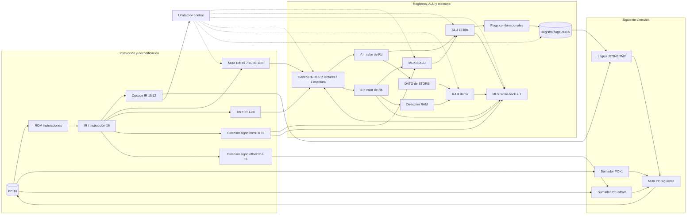

# Paso 3 — Diseño del datapath monociclo

**Versión:** 0.1 — 18/11/2026  
**Estado:** especificación lógica propuesta, validada con simulador de referencia; todavía **no implementada en Logisim Evolution**.  
**Dependencias:** [ISA](01-isa.md) y [formatos binarios](02-formatos-instrucciones.md).

## 1. Objetivo y criterio de diseño

Construir el camino de datos de un procesador Harvard que ejecuta una **instrucción de 16 bits por ciclo de reloj**, con ROM de instrucciones y RAM de datos separadas. No es un pipeline: FETCH, DECODE, EXECUTE, MEMORY y WRITE-BACK describen recorridos combinacionales de **un mismo ciclo**. El estado (PC, banco de registros, flags, RAM de datos) cambia simultáneamente en el flanco ascendente; las lecturas de ROM, registros y RAM son combinacionales para poder realizar LOAD en un solo ciclo.

Las especificaciones de este documento son **decisiones de ingeniería para el integrador base de 2025**, no una reproducción literal del MSP430 ni de RISC-V.

## 2. Diagrama de conexiones



> Diagrama lógico, no esquemático eléctrico. La unidad de control se desarrolla formalmente en el **paso 5**; aquí se fijan las interfaces y los comportamientos que deberá producir.

## 3. Bloques necesarios

| Bloque | Cantidad | Ancho / puertos | Comportamiento |
| --- | ---: | --- | --- |
| Registro PC | 1 | 16 bits, D/Q + clock + reset | Conserva dirección de instrucción actual; arranca en 0 |
| ROM instrucciones | 1 | palabra de 16 bits; dirección de palabra | Lectura combinacional `IR=ROM[PC]` |
| Extracción IR / splitters | varios | 16 → 4/4/4/4, 4/4/8, 4/12 | Extrae los campos; **IR es un cable combinacional**, no un registro de pipeline |
| Banco general | 1 | 12 × 16 bits, dos lecturas, una escritura | Lecturas combinacionales, escritura en flanco |
| MUX de registro Rd | 1 | 2 × 4 → 4 bits | Formato R: `IR[7:4]`; I: `IR[11:8]` |
| Extensor imm8 | 1 | 8 → 16 | Replica bit 7; salida `sext8` |
| Extensor offset12 | 1 | 12 → 16 | Replica bit 11; salida `sext12` |
| MUX ALU-B | 1 | 2 × 16 → 16 bits | `ReadB` o `sext8` |
| ALU | 1 | 2 entradas 16 bits, resultado 16 bits, flags | ADD, SUB, AND y OR requeridas por ISA; otras funciones internas optativas |
| RAM datos | 1 | palabra de 16 bits, dirección por palabra | Lectura combinacional, escritura en flanco; direccionada por ReadB |
| MUX de write-back | 1 | 4 × 16 → 16 bits | Selecciona ALU / ReadB / RAM / `sext8` |
| Registro de flags | 1 | 4 bits + write enable + clock + reset | Actualiza flags cuando `FlagWrite=1` |
| Sumador PC+1 | 1 | 16 bits | Avance secuencial |
| Sumador PC+offset | 1 | 16 bits | PC actual + `sext12` |
| MUX PC siguiente | 1 | 2 × 16 → 16 bits | Secuencial o salto tomado |
| Unidad de control | 1 | opcode y campos relevantes → señales | Paso 5 |

Los sumadores de PC son **independientes de la ALU de datos**. Es una decisión intencional que evita requerir una segunda operación de ALU en una misma instrucción y simplifica el datapath monociclo.

## 4. Anchos y campos de la instrucción

Se mantienen **exactamente** los formatos del paso 2:

- **R:** `IR[15:12] = opcode`; `IR[11:8] = Rs`; `IR[7:4] = Rd`; `IR[3:0] = 0`.
- **I:** `IR[15:12] = opcode`; `IR[11:8] = Rd`; `IR[7:0] = imm8`.
- **J:** `IR[15:12] = opcode`; `IR[11:0] = offset12`.

| Señal / bus | Ancho | Fuente |
| --- | ---: | --- |
| `PC`, `NextPC`, `PC+1`, `BranchPC` | 16 | PC / sumadores |
| `IR` | 16 | ROM |
| `opcode` | 4 | IR[15:12] |
| `Rs` | 4 | IR[11:8] (R) |
| `RdSeleccionado` | 4 | MUX(R:IR[7:4], I:IR[11:8]) |
| `ReadA` / `ReadB` | 16 cada uno | Banco de registros |
| `Imm16` | 16 | Extensión de signo de IR[7:0] |
| `Offset16` | 16 | Extensión de signo de IR[11:0] |
| `ALUB`, `ALUResult`, `RAMData`, `WriteBack` | 16 cada uno | MUX / ALU / RAM |
| `Z,N,C,V` | 1 cada uno | Registro de flags |

### 4.1. Banco de registros

- Dirección del **puerto A**: `RdSeleccionado` (R: `IR[7:4]`; I: `IR[11:8]`). El dato `ReadA` representa **Rd** en operaciones aritméticas, inmediatos y STORE.
- Dirección del **puerto B**: `IR[11:8]` para **instrucciones R**; `ReadB` representa **Rs**, que es fuente de ALU/MOV y **puntero de memoria** en LOAD/STORE.
- Dirección del **puerto de escritura**: `RdSeleccionado`; dato `WriteBack`; habilitación `RegWrite`.
- Los códigos 0..3 están reservados. Lecturas inválidas pueden cablearse a cero como protección, pero **la unidad de control debe anular todos los efectos** de una codificación inválida.
- El estado inicial del banco se puede definir como cero en la simulación, pero el programa de búsqueda inicializa explícitamente sus registros de trabajo; no depende de un reset general de los doce registros.

### 4.2. Memoria de datos

- Dirección `RAM_ADDR = ReadB = Reg[Rs]` (16 bits lógicos).
- Dato de STORE `RAM_DIN = ReadA = Reg[Rd]`.
- Dato de LOAD `RAM_DOUT = RAM[RAM_ADDR]`, enviado al MUX write-back.
- `MemWrite` determina si se realiza la escritura en el **flanco ascendente**.
- El diseño monociclo requiere lectura de datos combinacional; si la RAM configurada en Logisim introduce un ciclo adicional de latencia, **se debe cambiar su configuración o revisar la microarquitectura**, no afirmar que sigue siendo monociclo.
- La cantidad real M de palabras, el ancho del bus físico de dirección y la respuesta a accesos fuera de rango permanecen abiertos hasta configurar Logisim (paso 6). **No** se debe truncar en silencio una dirección de 16 bits a pocos bits y producir alias involuntarios.

## 5. Multiplexores de datos

### 5.1. `DestSel` (1 bit)

| Valor | Dirección de registro seleccionada | Instrucciones |
| --- | --- | --- |
| `0` | `IR[7:4]` | R (opcodes 0..7) |
| `1` | `IR[11:8]` | I (opcodes 8,9) |

En los saltos la dirección de registro es irrelevante, puesto que `RegWrite=0`.

### 5.2. `ALUSrc` (1 bit)

| Valor | Segundo operando ALU (`ALUB`) | Instrucciones que lo necesitan |
| --- | --- | --- |
| `0` | `ReadB` | ADD/SUB/AND/OR/CMP registro |
| `1` | `Imm16` | ADD inmediato |

El primer operando ALU siempre es `ReadA`. En instrucciones MOV, LOAD, STORE y saltos el resultado de ALU se ignora.

### 5.3. `WBSel` (2 bits)

| Valor | Dato escrito en Rd | Instrucciones |
| --- | --- | --- |
| `00` | `ALUResult` | ADD, SUB, AND, OR, ADD inmediato |
| `01` | `ReadB` | MOV registro |
| `10` | `RAM_DOUT` | LOAD |
| `11` | `Imm16` | MOV inmediato |

Para CMP, STORE y saltos el valor seleccionado no importa porque `RegWrite=0`.

## 6. Selección de siguiente PC

Se calculan en paralelo:

```text
PC_seq       = (PC_actual + 1) & 0xFFFF
PC_branch    = (PC_actual + sext12(IR[11:0])) & 0xFFFF
BranchTaken  = (opcode==JMP)
            OR ((opcode==JZ)  AND Z_reg_actual)
            OR ((opcode==JNZ) AND NOT Z_reg_actual)
NextPC       = BranchTaken ? PC_branch : PC_seq
```

**Se lee el Z previamente almacenado**, no el Z combinacional de ALU durante ese ciclo. En este ISA, las comparaciones y los saltos son instrucciones distintas. Una instrucción J solo consulta el registro de flags y nunca lo modifica.

La suma del offset usa el **PC de la instrucción actual**; por tanto `JMP 0` conserva el PC y representa un bucle infinito. No hay delay slots.

## 7. Flags y efectos de estado

- `ADD`, `SUB`, `CMP`, `ADD #imm`: `FlagWrite=1`, se escriben Z/N/C/V calculados por ALU.
- `AND`, `OR`: `FlagWrite=1`, Z/N según ALU; C=V=0 como decisión provisional del paso 1.
- `MOV` (todas las variantes), LOAD, STORE, saltos: `FlagWrite=0`.
- `CMP` **solo escribe flags**. No modifica Rd.
- `Z = (ALUResult == 0)`; `N = ALUResult[15]`. Para suma, `C=carry_out`; para resta y CMP `C=borrow = NOT(carry_out de A+~B+1)`. `V` detecta overflow firmado.

La implementación física de la ALU, el acarreo/préstamo y las ecuaciones de V se detallarán y probarán de nuevo en el **paso 4**.

## 8. Contrato preliminar con la unidad de control

Señales que el decodificador deberá producir en el paso 5:

- `RegWrite` (1 bit), `MemWrite` (1 bit), `FlagWrite` (1 bit).
- `DestSel` (1 bit), `ALUSrc` (1 bit).
- `WBSel` (2 bits), `ALUOp` (al menos 2 bits para ADD/SUB/AND/OR).
- `BranchKind` (NINGUNO/JZ/JNZ/JMP), o directamente `BranchTaken` a partir de opcode + Z.
- `ValidInstr` (1 bit): habilita efectos para codificaciones válidas.

**Tabla de comportamiento mínima** (`-` significa *don't care*, no una salida eléctrica flotante):

| Opcode | Instrucción | DestSel | ALUSrc | ALUOp | WBSel | RegWrite | MemWrite | FlagWrite | Próximo PC |
| --- | --- | :---: | :---: | --- | :---: | :---: | :---: | :---: | --- |
| 0 | ADD R | 0 | 0 | ADD | 00 | 1 | 0 | 1 | PC+1 |
| 1 | SUB R | 0 | 0 | SUB | 00 | 1 | 0 | 1 | PC+1 |
| 2 | AND R | 0 | 0 | AND | 00 | 1 | 0 | 1 | PC+1 |
| 3 | OR R | 0 | 0 | OR | 00 | 1 | 0 | 1 | PC+1 |
| 4 | CMP R | 0 | 0 | SUB | -- | 0 | 0 | 1 | PC+1 |
| 5 | MOV R | 0 | -- | -- | 01 | 1 | 0 | 0 | PC+1 |
| 6 | LOAD | 0 | -- | -- | 10 | 1 | 0 | 0 | PC+1 |
| 7 | STORE | 0 | -- | -- | -- | 0 | 1 | 0 | PC+1 |
| 8 | MOV I | 1 | -- | -- | 11 | 1 | 0 | 0 | PC+1 |
| 9 | ADD I | 1 | 1 | ADD | 00 | 1 | 0 | 1 | PC+1 |
| A | JZ | -- | -- | -- | -- | 0 | 0 | 0 | Z ? PC+offset : PC+1 |
| B | JNZ | -- | -- | -- | -- | 0 | 0 | 0 | !Z ? PC+offset : PC+1 |
| C | JMP | -- | -- | -- | -- | 0 | 0 | 0 | PC+offset |
| D–F | Reservados | -- | -- | -- | -- | 0 | 0 | 0 | PC+1 (política segura) |

En formato R debe comprobarse `IR[3:0]==0000`, y deben validarse los códigos de `Rs` y `Rd`. En I se valida Rd. Si el campo requerido es inválido, la instrucción **no produce escrituras ni cambios de flags y avanza PC+1**: es un comportamiento defensivo del prototipo, no un `NOP` agregado oficialmente al ISA.

## 9. Orden lógico dentro de un ciclo

1. El `PC` del ciclo anterior proporciona la dirección de ROM.
2. ROM entrega `IR`; se decodifican opcode y campos.
3. Se leen combinacionalmente `ReadA` y `ReadB` del banco.
4. En paralelo: ALU calcula resultado/flags, RAM lee si corresponde y los dos sumadores de PC calculan secuencial/relativo.
5. Los multiplexores seleccionan `WriteBack` y `NextPC`; el control habilita (o no) escrituras.
6. En el mismo **flanco ascendente** se captura `NextPC`, se escribe Rd si `RegWrite`, se actualizan flags si `FlagWrite` y se escribe RAM si `MemWrite`.

No hay registros intermedios entre las etapas. El período de reloj debe cubrir el camino combinacional más lento (por ejemplo, PC→ROM→lectura de registros→RAM→write-back→registro de destino), más los tiempos secuenciales correspondientes.

## 10. Ejemplos completos de recorrido

**ADD R5, R4 (`0x0540`):** `ReadA=R4`; `ReadB=R5`; ALU ADD; `WBSel=00`; `RegWrite=1`; `FlagWrite=1`; `NextPC=PC+1`. En flanco: R4 y flags cambian.

**ADD #1, R4 (`0x9401`):** `RdSeleccionado=IR[11:8]=R4`; `ALUSrc=1`; ALU calcula `R4+0x0001`; resultado y flags se escriben; PC+1.

**MOV @R7, R6 (`0x6760`):** `ReadB=R7` determina dirección RAM; `RAM_DOUT` entra al MUX WB; `RdSeleccionado=R6`; `RegWrite=1`; flags conservados; PC+1.

**MOV R6, @R7 (`0x7760`):** `ReadB=R7` determina dirección RAM; `ReadA=R6` es el dato que se escribe; `MemWrite=1`, `RegWrite=0`; PC+1.

**CMP R5, R6 (`0x4560`):** ALU calcula `R6-R5`; `FlagWrite=1`; `RegWrite=0`; R6 se conserva; PC+1.

**JZ +6 (`0xA006`):** se consulta Z almacenado. Si vale 1, `NextPC=PC+6`; si vale 0, `NextPC=PC+1`; no hay otra escritura.

## 11. Pruebas y alcance de la validación

Se agrega un **simulador de referencia a nivel ISA/datapath**, que no pretende ser Logisim ni prueba la temporización eléctrica. La suite comprueba las rutas ADD/SUB/AND/OR, MOV, LOAD, STORE, CMP, immediatos, flags, saltos tomados/no tomados, codificaciones reservadas y ejecución de búsqueda para varios arreglos.

Ejecutar desde la raíz del repositorio:

```bash
python tests/verificar_codificacion.py
python tests/verificar_datapath.py
```

Resultados del script: ver salida de consola. No se declara validada todavía la implementación física de Logisim, que se abordará en los pasos 4–6.

## 12. Pendientes antes de construir el circuito

- ALU de clases: adaptar y documentar exactamente sus operaciones y flags en el paso 4.
- Formalizar las ecuaciones de decodificación y los valores de señales en el paso 5.
- Definir parámetros N/M, comportamiento fuera de rango y configuración exacta de ROM/RAM para Logisim en el paso 6.
- Consultar la discrepancia OR/XOR de la consigna y la convención de C en restas.
- Incorporar la instrucción específica de 2026, si la cátedra la asigna, sin romper los formatos ya definidos salvo necesidad justificada.

**Fuentes consultadas:** consigna integrador 2025; apuntes consolidados clases 1–6, especialmente clases 3 (registros y sistema síncrono), 5 (ISA y principios de diseño) y 6 (secuencias de instrucciones); programa de la asignatura Resolución CD 336/25, Unidad 5 (procesador de ciclo único).
